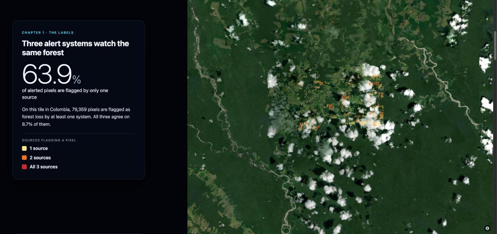

# Orbitree — Detecting Deforestation from Space

**Live demo: [orbitree-six.vercel.app](https://orbitree-six.vercel.app)**



My solo entry to the **osapiens Terra Makeathon 2026**: pixel-level detection of forest loss after 2020 from multimodal satellite data, to support the EU Deforestation Regulation (EUDR). Train and test tiles come from different regions, and the only supervision is three weak alert systems that often disagree.

**Orbitree** is the web app that tells the project's story on a 3D globe. It shows where the weak labels disagree, how the model works, and what it predicts in regions whose labels it never trained on. It ends in a free explore mode.

## Results

| Model | Val F1 | Val IoU | Leaderboard Union IoU |
|---|---|---|---|
| `temporal_s2s1_norm_v1` (S2 + S1, z-scored, modality masks) | 0.743 | 0.597 | 40.29% |
| `temporal_s2s1_norm_pseudo_v1` (final; retrained on 2-teacher pseudo-labels) | **0.763** | **0.622** | n/a |

Validation uses three fixed train tiles (`18NXH_6_8`, `48PXC_7_7`, `48QVE_3_0`). Test tiles have no ground truth, so the app compares predictions with public RADD alerts instead of scoring them.

## Approach in brief

- **Inputs, per tile and year:** 64-dim AlphaEarth Foundation (AEF) embeddings, Sentinel-2 NDVI/NBR cloud-masked annual composites, Sentinel-1 VV ascending/descending annual medians, and validity masks. 71 channels in total.
- **Model:** a temporal change-detection U-Net. Per-channel z-scoring, explicit modality masks and modality dropout let it cope with cloudy years and missing orbits.
- **Weak labels:** GLAD-S2, GLAD-L and RADD are fused by majority vote.
- **Loss:** BCE (positive weight 3) plus Tversky (α = 0.3, β = 0.7). Missing deforestation costs more than a false alarm.
- **Pseudo-labels:** two teachers (S2-only and S2+S1) label the unlabelled test tiles. Uncertain pixels are masked out of the loss, and the student is retrained on these labels.
- **Submission:** threshold sweep, polygonisation, a 0.5 ha minimum area, then a GeoJSON FeatureCollection.

The full write-up, with every experiment, loss setting and lesson, is in [APPROACH.md](./APPROACH.md). Pitch slides are in [`slides/`](./slides).

## Repository map

| Path | What it is |
|---|---|
| [`src/`](./src) | ML pipeline: feature caches (`s1_features.py`, `s2_features.py`), label fusion (`labels.py`), U-Net and Clay models, training, pseudo-labels, prediction, submission |
| [`web/`](./web) | **Orbitree** web app (Vite + React + TypeScript + MapLibre GL v5) |
| [`tools/web_data/`](./tools/web_data) | Builds the app's static data from the public labels and the submission GeoJSONs |
| [`viewer/`](./viewer), [`serve_visualizer.py`](./serve_visualizer.py) | Local browser viewer for raw tiles, labels and prediction overlays |
| [`APPROACH.md`](./APPROACH.md) | Technical write-up |
| [`challenge.ipynb`](./challenge.ipynb), [`osapiens-challenge-full-description.md`](./osapiens-challenge-full-description.md) | Original challenge notebook and brief |
| [`submission_utils.py`](./submission_utils.py) | `raster_to_geojson()`: binary raster to submission GeoJSON |
| [`docs/superpowers/`](./docs/superpowers) | Design spec and implementation plan for Orbitree |

## Orbitree web app

A static site with no backend and no environment variables.

1. **Opening:** a realistic globe with the 16 train tiles and 5 test tiles.
2. **The labels:** a Colombian train tile where GLAD-S2, GLAD-L and RADD agree, and mostly don't.
3. **The approach:** the pipeline and the pseudo-label retrain loop.
4. **Unlabelled regions:** predictions in Colombia, Cameroon and Cambodia, next to RADD alerts from Global Forest Watch.
5. **Explore:** toggle layers, switch between the 9 submitted model versions, and fly to any tile.

The app is built for desktop and projectors, and stays usable on phones. If Esri imagery fails, it falls back to EOX Sentinel-2 cloudless.

### Run locally

```bash
cd web
npm ci
npm run dev        # http://localhost:5173
npm test           # unit tests (vitest)
npm run build      # static site in web/dist
```

### Rebuild the data (optional)

`web/public/data/` is committed. To regenerate it from the public challenge labels (about 4 MB, downloaded automatically) and a folder of submission GeoJSONs:

```bash
uv venv .venv-web --python 3.11
uv pip install --python .venv-web -r tools/web_data/requirements.txt
.venv-web/bin/python -m tools.web_data.build --submissions ../MAKEATHON --out web/public/data
```

### Deploy

The live site is deployed from `web/` with the Vercel CLI:

```bash
cd web && vercel deploy --prod
```

To use Git integration instead, import the repository, set the **root directory** to `web`, and use the **Vite** preset (`npm run build`, output `dist`). `web/vercel.json` enables clean URLs and caches `/data/*` for one hour.

## Reproducing the ML pipeline

```bash
make install                 # .venv + requirements
make download_data_from_s3   # public S3, no credentials; writes data/makeathon-challenge/
```

The modules in `src/` are run with `python -m src.<module>` from the repository root. See [APPROACH.md](./APPROACH.md) §7–§9 for the training, inference and submission flow and the hyperparameters.

<details>
<summary>Dataset layout</summary>

```text
data/makeathon-challenge/
├── sentinel-1/{train,test}/{tile_id}__s1_rtc/{tile_id}__s1_rtc_{year}_{month}_{ascending|descending}.tif
├── sentinel-2/{train,test}/{tile_id}__s2_l2a/{tile_id}__s2_l2a_{year}_{month}.tif
├── aef-embeddings/{train,test}/{tile_id}_{year}.tiff
├── labels/train/{gladl,glads2,radd}/
└── metadata/{train,test}_tiles.geojson
```

</details>

### Local raw-data viewer

To inspect the downloaded rasters (S2 true colour, S1 backscatter, AEF pseudo-RGB, weak labels, a month scrubber and prediction overlays from `submission/`):

```bash
make visualize_browser       # http://127.0.0.1:8765
```

## Data and credits

- Challenge data and weak labels (GLAD-S2, GLAD-L, RADD): osapiens Terra Makeathon 2026.
- Basemap: Esri World Imagery (Esri, Maxar, Earthstar Geographics, GIS User Community); fallback: EOX Sentinel-2 cloudless.
- RADD alerts in the app: Wageningen University / Global Forest Watch. Tree cover loss: Hansen/UMD/Google/USGS/NASA.

Built by Utku Kalkanlı.
